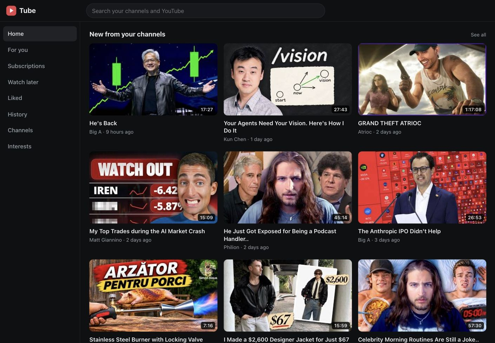
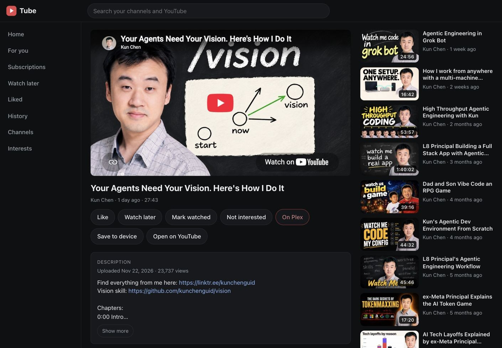
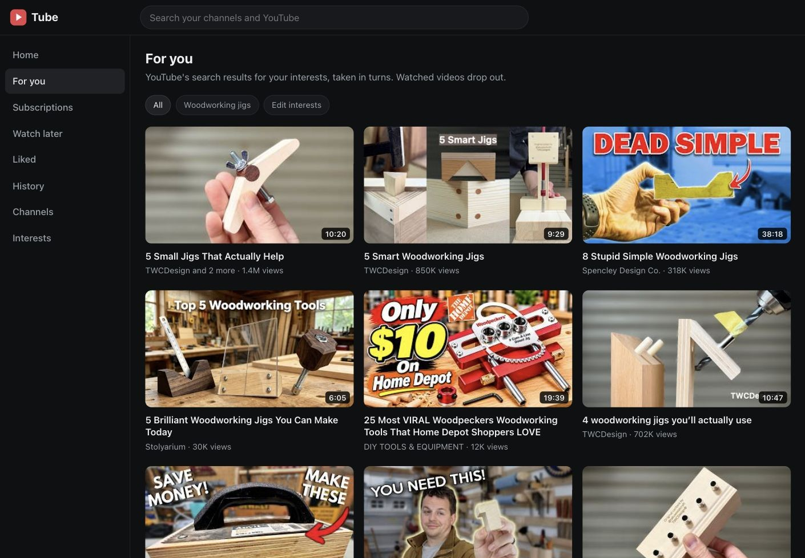

<div align="center">

# 📺 Tube

**A private front page for YouTube: your subscriptions, plus searches for the interests you name.**

*No Shorts, no autoplay, no infinite scroll, no YouTube home page.*

<br>



*Home opens on the newest uploads from the channels you chose. Nothing else gets in.*

</div>

---

## Why this exists

Three honest reasons:

1. **I open YouTube for one video and leave an hour later.** The home page, Shorts and autoplay are built for that. Tube shows only two things: what my channels uploaded, and results for topics I typed in myself.
2. **I did not want a recommendation engine.** "For you" is plain YouTube search, run once a day for each interest and taken in turns. I can read the whole rule in one function.
3. **My watch history should live on my machine.** Subscriptions, likes, watch later and history sit in one SQLite file. Tube needs no Google account and no API key: `yt-dlp` and the channel RSS feeds do the reading.

<div align="center">


*The watch page: the video, a few buttons, the description, and more from the same channel.*
</div>

---

## What it does

| | |
|---|---|
| 📡 **Subscriptions** | Newest uploads from your channels, newest first. Add a channel by URL, `@handle` or `UC...` id, and remove it in the app. Channels are checked every hour with `yt-dlp`. Upload dates come from the channel RSS feed. |
| 🎯 **Interests** | Name what you are into ("woodworking jigs"). Each interest is searched on YouTube once a day with `yt-dlp`. Shorts and anything under 90 seconds are left out. |
| ✨ **For you** | The interests' results, taken in turns: each interest's first result, then each one's second. Watched and "Not interested" videos drop out. Filter by one interest with a chip. |
| 🔎 **Search** | Your channels by title, plus a live YouTube search. |
| 🏠 **Home shelves** | Continue watching, New from your channels, For you, Watch later. A shelf shows only when it has videos. |
| 🔖 **Watch later, liked, history, resume** | Stored in `data/state.db`. A video you left after the first 30 seconds starts where you stopped. |
| 📝 **Description** | Fetched from YouTube the first time you open a video, then served from the database. |
| 💾 **Download to Plex** | One button on any video. `yt-dlp` saves an mp4 (H.264, up to 720p) with metadata and cover embedded into `download_dir`. One download at a time. A queued video says how many are in front ("Waiting for 2 other downloads…"). Remove `download_dir` from `tube.json` to switch it off. |
| 📥 **Save to device** | A second button hands the video file to the phone or laptop you are on. If the server does not have the file yet, it fetches it first (so it lands on Plex too) and the save starts by itself. |
| 📱 **Installable** | A web app manifest, icons and a service worker. Over HTTPS it installs to the home screen and the app shell opens even when the server is unreachable. |
| 🔒 **One token** | Every `/api` route needs the app token from `tube.json`. You paste it once per browser. |

- Videos play through the `youtube-nocookie.com` embed.
- Lists grow only when you press "Show more".

<div align="center">


*"For you", built from a single interest: "Woodworking jigs".*
</div>

---

## Run

Needs Python 3 and [`yt-dlp`](https://github.com/yt-dlp/yt-dlp) on the `PATH`. Downloads also need `ffmpeg`.

```sh
# 1. Config
cp server/tube.example.json server/tube.json   # then set "token": openssl rand -hex 24

# 2. Run
python3 server/tube.py                           # http://localhost:8791, paste the token once per browser
```

On the first start Tube subscribes to the channels in `server/channels.seed.json`. Edit that file before the first start, or add and remove channels in the app later.

---

## Configure

Everything is in `server/tube.json`. Set `TUBE_CONFIG` to load it from another path.

| Key | Default | What |
|---|---|---|
| `token` | none, required | The app token. The server does not start without it. |
| `port` | `8791` | Port to listen on. |
| `bind` | `0.0.0.0` | Address to listen on. |
| `data_dir` | `../data` | Folder for `state.db`, relative to the config file. |
| `ytdlp` | `yt-dlp` | The `yt-dlp` binary to run. |
| `refresh_minutes` | `60` | How often the channels are checked. |
| `interest_refresh_hours` | `24` | How often each interest is searched again. |
| `download_dir` | not set | Folder for "Download to Plex". Leave it out to switch downloads off. |
| `download_height` | `720` | Highest resolution to download. |
| `download_min_free_gb` | `10` | Downloads are skipped when the disk has less free space than this. |

---

## Docker

```sh
rsync -av --exclude tube.json --exclude __pycache__ docker-compose.yml .dockerignore server deploy homelab:/DATA/Sites/tube/
ssh homelab 'cd /DATA/Sites/tube && docker compose up -d --build'
```

- The image carries its own `yt-dlp`, `ffmpeg` and `deno`. yt-dlp updates at start and once a day.
- `"ytdlp": "yt-dlp"` in `tube.json` uses the copy in the image.
- The download folder has the same path inside the container as on the host, so `tube.json` uses host paths. Change the volume in `docker-compose.yml` to match your `download_dir`.
- The `x-casaos` block gives the CasaOS tile its name and icon. Plain `docker compose` ignores it.

`server/tube.json` lives only on the server. `data/state.db` (subscriptions, history) is created there and is never overwritten by a deploy.

---

## Tests

```sh
python3 -m unittest discover -s tests
```

The tests use fakes for `yt-dlp` and the RSS feed. They never touch the network.

---

## Layout

| Path | What |
|---|---|
| `server/tube.py` | The server. Python standard library only. |
| `server/web/` | The web app. Plain JS, no build step. |
| `server/channels.seed.json` | Channels subscribed on first start. |
| `server/tube.example.json` | Config template. Copy it to `server/tube.json`. |
| `docker-compose.yml`, `deploy/` | The container: `Dockerfile` and its entrypoint. |
| `tests/` | `python3 -m unittest discover -s tests` |
